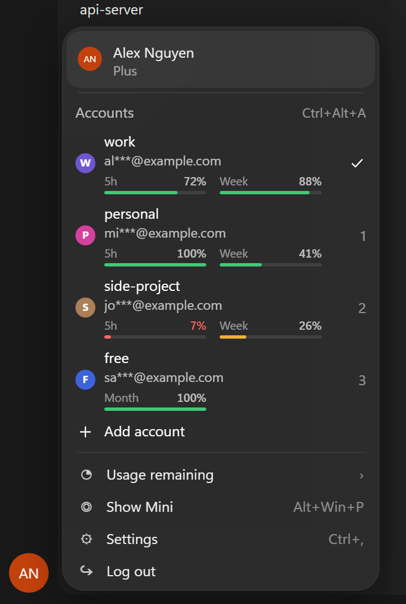
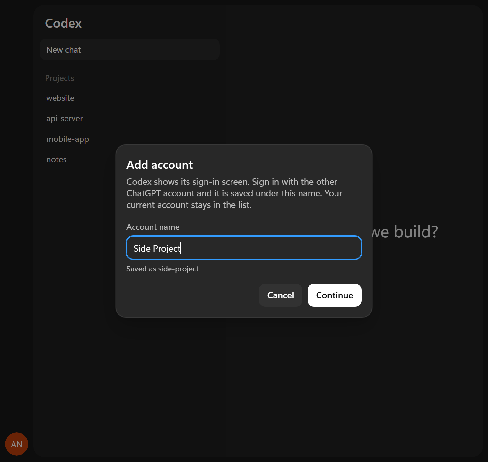

# Codex Multi-Profile

<p align="center">
  <a href="https://github.com/Hung2124/codex-multi-profile/actions/workflows/ci.yml"></a>
  <a href="https://www.npmjs.com/package/codex-multi-profile"></a>
  <a href="https://github.com/Hung2124/codex-multi-profile/stargazers"></a>
  <a href="https://github.com/Hung2124/codex-multi-profile/releases"></a>
  <a href="LICENSE"></a>
  
  
</p>

<p align="center">
  <strong>Multi-workspace profile router, MCP server security auditor, and <code>CLAUDE.md</code> &harr; <code>AGENTS.md</code> instruction bridge for Claude Code and OpenAI Codex.</strong><br>
  Isolate Enterprise, Open-Source Maintainer, and Personal agent environments across repositories.
</p>

<p align="center">
  <a href="README.vi.md">Tiếng Việt</a> &middot;
  <a href="docs/architecture.md">How it works</a> &middot;
  <a href="docs/troubleshooting.md">Troubleshooting</a> &middot;
  <a href="SUPPORT.md">Support</a>
</p>

<p align="center">
  
</p>

> Built for developers, open-source maintainers, and consulting engineers who work across separate **authorized** Enterprise SSO, Client, and Personal workspaces in **Claude Code** and **OpenAI Codex**.

## Core Capabilities (v2.0)

| Module | What it solves |
|:---|:---|
| **Claude Code & Codex Profile Store** (`WorkspaceProfileStore`) | Isolate `~/.claude/settings.json`, `~/.codex`, and workspace `.mcp.json` profiles (`enterprise`, `oss-maintainer`, `research`) with atomic file swaps |
| **MCP Security & Isolation Auditor** (`mcp-audit`) | Statically audits `.mcp.json` and `claude_desktop_config.json` for hardcoded credentials (`sk-ant-*`, `ghp_*`), non-loopback HTTP/SSE endpoints, and unsafe shell wrappers |
| **Instruction Bridge** (`sync-docs`) | Deterministically synchronizes shared engineering rules between `CLAUDE.md` (Claude Code) and `AGENTS.md` (OpenAI Codex) across polyglot repositories |
| **Windows Store Codex Workspace Switcher** | Hot-switches authorized Enterprise, Team, and Personal workspaces in 2–3 seconds directly from the Microsoft Store Codex avatar menu |

## Cross-Platform CLI & Node.js SDK (Claude Code, MCP & Codex)

Requires Node.js 18+ on macOS, Linux, or Windows:

```bash
# Install globally or invoke via npx
npm install -g codex-multi-profile

# 1. Audit .mcp.json for secret leakage and non-loopback MCP transports
npx codex-multi-profile mcp-audit .mcp.json

# 2. Synchronize CLAUDE.md <-> AGENTS.md instructions in a repository
npx codex-multi-profile sync-docs .

# 3. List isolated Claude Code (~/.claude) or Codex (~/.codex) profiles
npx codex-multi-profile profiles claude
```

### Programmatic SDK Usage (Node.js / TypeScript)

```javascript
const {
  WorkspaceProfileStore,
  auditMcpConfig,
  syncWorkspaceInstructions
} = require("codex-multi-profile");

// 1. Audit an MCP configuration before activating a workspace profile
const audit = auditMcpConfig({
  mcpServers: {
    github: {
      command: "npx",
      args: ["-y", "@modelcontextprotocol/server-github"],
      env: { GITHUB_PERSONAL_ACCESS_TOKEN: "${GITHUB_PERSONAL_ACCESS_TOKEN}" }
    }
  }
});
if (!audit.valid) throw new Error("MCP security audit failed");

// 2. Save and activate an isolated Claude Code profile
const store = new WorkspaceProfileStore();
store.saveProfile("oss-maintainer", {
  agent: "claude",
  settings: { model: "claude-sonnet-4-5" }
});
store.activateProfile("oss-maintainer", { agent: "claude", workspaceDir: process.cwd() });

// 3. Keep CLAUDE.md and AGENTS.md aligned
syncWorkspaceInstructions(process.cwd(), { direction: "claude-to-codex" });
```

---

## Native Windows Desktop Integration (Microsoft Store Codex App)

Click your avatar at the bottom-left of the Windows Store Codex app. Under your identity row there is an **Accounts** workspace section:

| In the menu | Does |
|:---|:---|
| Click a workspace profile | Switches to that workspace in 2-3 seconds; the Codex window stays open (from a sign-in screen Codex restarts, ~10 s) |
| **Add account** | Codex restarts on its sign-in screen; sign in with your other authorized workspace and save it under a profile label |
| Pencil / trash (hover a row) | Rename / remove a saved workspace profile (the active profile cannot be removed) |
| `1`-`9` while the menu is open | Activate the workspace profile with that number |
| `Ctrl+Alt+A` | Open the workspace switcher from anywhere in Codex |
| Telemetry bars | Displays remaining session quota windows (5h and weekly windows) per workspace; hover for reset timestamp |

The menu follows the application's language (Vietnamese or English) and its light / dark theme.

<p align="center">
  
</p>

<sub>Screenshots use synthetic profiles; rendered from <code>switcher-inject.js</code> with
<code>node tools/screenshots/capture.mjs</code>.</sub>

## Install (Windows Desktop Helper)

Requires Windows 10/11 and [Codex](https://chatgpt.com/codex) from the Microsoft Store:

```powershell
irm https://raw.githubusercontent.com/Hung2124/codex-multi-profile/main/install.ps1 | iex
```

Or via **npm / npx** (Node.js 18+):

```powershell
npx codex-multi-profile install
```

This registers the currently signed-in workspace as `main`, places a **Codex** shortcut on the Desktop and Start menu, and starts a lightweight background watcher at sign-in (~25 MB, no window). `-NoAutoStart` skips the startup watcher.

Upgrading from the legacy 0.1–0.2 clone-based layout:

```powershell
$env:CODEX_MP_REMOVE_LEGACY = '1'; irm https://raw.githubusercontent.com/Hung2124/codex-multi-profile/main/install.ps1 | iex
```

## Good to know

- **Use the profile menu instead of "Log out" when switching workspaces.** Logging out inside the app revokes the active refresh token on the server.
- A saved session that expired shows the sign-in screen after switching; signing in again refreshes the stored profile automatically.
- Active streaming generations are stopped cleanly before swapping credentials.
- The local helper runs only while the app is open (~130 MB, near-zero CPU).

## Command line (CI, agents, scripts)

```powershell
# Cross-platform MCP & instruction tooling:
codex-multi-profile mcp-audit .mcp.json --json
codex-multi-profile sync-docs .
codex-multi-profile profiles claude --json

# Windows Desktop workspace profile management:
codex-multi-profile list --json
codex-multi-profile status
codex-multi-profile switch enterprise

# Or directly via PowerShell:
$cli = "$env:LOCALAPPDATA\CodexMultiProfile\CodexAccounts.ps1"
powershell -NoProfile -ExecutionPolicy Bypass -File $cli list      # or: status | save -Name x | switch -Name x | rename -Name x -NewName y | remove -Name x | lang -Name vi
```

## Uninstall

```powershell
powershell -NoProfile -ExecutionPolicy Bypass -File "$env:LOCALAPPDATA\CodexMultiProfile\Uninstall-CodexMultiProfile.ps1"   # add -RemoveAccounts to delete saved profiles
```

`~\.codex` and `~\.claude` (conversations, project memory, and active settings) are never deleted.

## Privacy and security

- Saved workspace profiles stay on disk (`%LOCALAPPDATA%\CodexMultiProfile` on Windows or `~/.config/codex-multi-profile` on macOS/Linux). Nothing is transmitted externally.
- The UI layer only ever receives masked emails (`ab***@example.com`), never raw tokens.
- The `mcp-audit` command flags plaintext secrets in `.mcp.json` before they can be committed or loaded into an untrusted workspace.
- Application binaries are never modified. See [docs/architecture.md](docs/architecture.md) and [SECURITY.md](SECURITY.md).

## License

MIT
