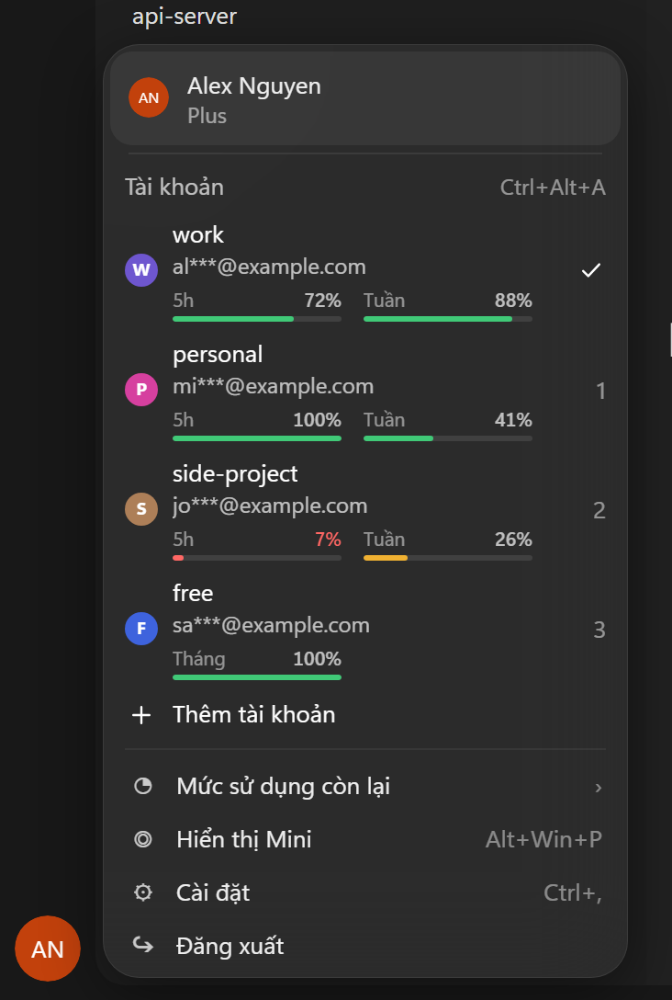

# Codex Multi-Profile

<p align="center">
  <strong>Bộ định tuyến hồ sơ đa không gian làm việc (Multi-Workspace Profile Router), kiểm toán bảo mật MCP Server (<code>.mcp.json</code>), và cầu nối đồng bộ <code>CLAUDE.md</code> &harr; <code>AGENTS.md</code> cho Claude Code và OpenAI Codex.</strong><br>
  Cô lập môi trường Enterprise SSO, Open-Source Maintainer và Personal trên cùng một máy.
</p>

<p align="center">
  <a href="README.md">English</a> &middot;
  <a href="docs/claude-code-mcp.md">Claude Code &amp; MCP Guide</a> &middot;
  <a href="docs/architecture.md">Cách hoạt động</a> &middot;
  <a href="docs/troubleshooting.md">Khắc phục sự cố</a>
</p>

<p align="center">
  
</p>

> Công cụ mã nguồn mở dành cho lập trình viên, open-source maintainer và kỹ sư tư vấn làm việc trên nhiều không gian làm việc (Enterprise, Client, Personal) **hợp lệ** trong **Claude Code** và **OpenAI Codex**.

## Tính năng cốt lõi (v2.0)

| Phân hệ | Chức năng |
|:---|:---|
| **Claude Code & Codex Profile Store** (`WorkspaceProfileStore`) | Cô lập hồ sơ `~/.claude/settings.json`, `~/.codex`, và `.mcp.json` (`enterprise`, `oss-maintainer`, `research`) bằng cơ chế hoán đổi file nguyên tử (atomic swap) |
| **Kiểm toán bảo mật MCP** (`mcp-audit`) | Phân tích tĩnh `.mcp.json` và `claude_desktop_config.json`, phát hiện sớm khóa API lộ thiên (`sk-ant-*`, `ghp_*`), kết nối HTTP/SSE không mã hóa và shell wrapper |
| **Đồng bộ chỉ dẫn** (`sync-docs`) | Đồng bộ hai chiều giữa `CLAUDE.md` (Claude Code) và `AGENTS.md` (OpenAI Codex) trong các dự án đa công cụ |
| **Chuyển đổi Workspace trên Codex Windows** | Chuyển nhanh giữa các workspace Enterprise, Team và Personal trong 2-3 giây ngay từ menu avatar của ứng dụng Codex |

## CLI Đa nền tảng & Node.js SDK (macOS, Linux, Windows)

```bash
# Kiểm toán bảo mật file cấu hình MCP (.mcp.json)
npx codex-multi-profile mcp-audit .mcp.json

# Đồng bộ chỉ dẫn CLAUDE.md <-> AGENTS.md
npx codex-multi-profile sync-docs .

# Liệt kê các hồ sơ Claude Code (~/.claude) đã cô lập
npx codex-multi-profile profiles claude
```

## Tích hợp Menu trên Windows (Ứng dụng Codex Microsoft Store)

Bấm avatar ở góc dưới bên trái Codex. Ngay dưới tên bạn có mục **Tài khoản**:

| Trong menu | Tác dụng |
|:---|:---|
| Bấm một hồ sơ workspace | Chuyển sang workspace đó trong 2-3 giây, cửa sổ giữ nguyên (nếu đang ở màn hình đăng nhập thì khởi động lại, ~10 giây) |
| **Thêm tài khoản** | Khởi động lại ở màn hình đăng nhập; đăng nhập workspace hợp lệ khác để lưu dưới tên hồ sơ mới |
| Bút chì / thùng rác (rê chuột vào dòng) | Đổi tên / xoá hồ sơ đã lưu (không xoá được hồ sơ đang hoạt động) |
| Phím `1`-`9` khi menu đang mở | Chọn hồ sơ workspace theo số |
| `Ctrl+Alt+A` | Mở menu chuyển đổi từ bất kỳ đâu |
| Thanh mức sử dụng | Hiển thị hạn mức phiên làm việc còn lại (cửa sổ 5h và Tuần) của từng workspace; rê chuột để xem thời điểm đặt lại |

Menu theo ngôn ngữ của Codex (Việt/Anh) và theo giao diện sáng/tối.

<sub>Ảnh minh hoạ dùng tài khoản giả, được dựng từ chính <code>switcher-inject.js</code> bằng
<code>node tools/screenshots/capture.mjs</code>.</sub>

## Cài đặt

Cần Windows 10/11, [Codex](https://chatgpt.com/codex) từ Microsoft Store, đã đăng nhập một lần.

```powershell
irm https://raw.githubusercontent.com/Hung2124/codex-multi-profile/main/install.ps1 | iex
```

Trình cài đặt lưu tài khoản Codex đang dùng thành `main`, tạo shortcut **Codex** trên Desktop và Start menu, và bật một
trình theo dõi siêu nhẹ chạy cùng Windows (~25 MB, không có cửa sổ). Mở Codex kiểu nào cũng được: từ icon gốc trên
taskbar / Start thì Codex tự khởi động lại một lần trong vài giây đầu để có menu; từ shortcut **Codex** thì có menu ngay
(ghim shortcut này để khỏi phải khởi động lại). `-NoAutoStart` để không dùng trình theo dõi.

Nâng cấp từ bản cũ dùng clone (shortcut Codex1 / Codex Main / Codex Accounts)? Lệnh này nhập các tài khoản
đã lưu, xoá bản cũ và các bản sao `ChatGPT.exe`:

```powershell
$env:CODEX_MP_REMOVE_LEGACY = '1'; irm https://raw.githubusercontent.com/Hung2124/codex-multi-profile/main/install.ps1 | iex
```

## Nên biết

- **Đừng dùng "Đăng xuất" của Codex để đổi tài khoản.** Nó có thể làm hỏng bản đăng nhập đã lưu. Hãy dùng menu.
- Tài khoản có đăng nhập đã hết hạn sẽ hiện màn hình đăng nhập sau khi chuyển. Đăng nhập lại đúng tài khoản đó là
  được lưu tự động. Góc dưới trái vẫn có nút tài khoản nhỏ để chuyển sang tài khoản khác.
- Câu trả lời Codex đang viết dở sẽ dừng khi bạn chuyển tài khoản (đăng nhập thay đổi giữa chừng).
- Trình hỗ trợ menu là một tiến trình PowerShell ẩn, chỉ chạy khi Codex mở (~130 MB, gần như không tốn CPU).

## Dòng lệnh

```powershell
$cli = "$env:LOCALAPPDATA\CodexMultiProfile\CodexAccounts.ps1"
powershell -NoProfile -ExecutionPolicy Bypass -File $cli list      # hoặc: status | save -Name x | switch -Name x | rename -Name x -NewName y | remove -Name x | lang -Name vi
```

## Gỡ cài đặt

```powershell
powershell -NoProfile -ExecutionPolicy Bypass -File "$env:LOCALAPPDATA\CodexMultiProfile\Uninstall-CodexMultiProfile.ps1"   # thêm -RemoveAccounts để xoá các tài khoản đã lưu
```

`~\.codex` (chat, cài đặt, tài khoản đang dùng) không bao giờ bị động tới.

## Riêng tư và bảo mật

- Tài khoản đã lưu chỉ nằm trên máy này ở `%LOCALAPPDATA%\CodexMultiProfile\accounts`. Không gửi đi đâu cả.
- Cửa sổ Codex chỉ nhận email đã che (`ab***@example.com`), không bao giờ nhận token.
- Menu nói chuyện với trình hỗ trợ qua Chrome DevTools protocol chỉ trên `127.0.0.1`. Các chương trình khác chạy
  dưới tài khoản Windows của bạn cũng có thể chạm tới cổng này; nếu điều đó quan trọng với máy bạn thì đừng dùng công cụ này.
- Không sửa file nào của Codex. Xem [docs/architecture.md](docs/architecture.md).
